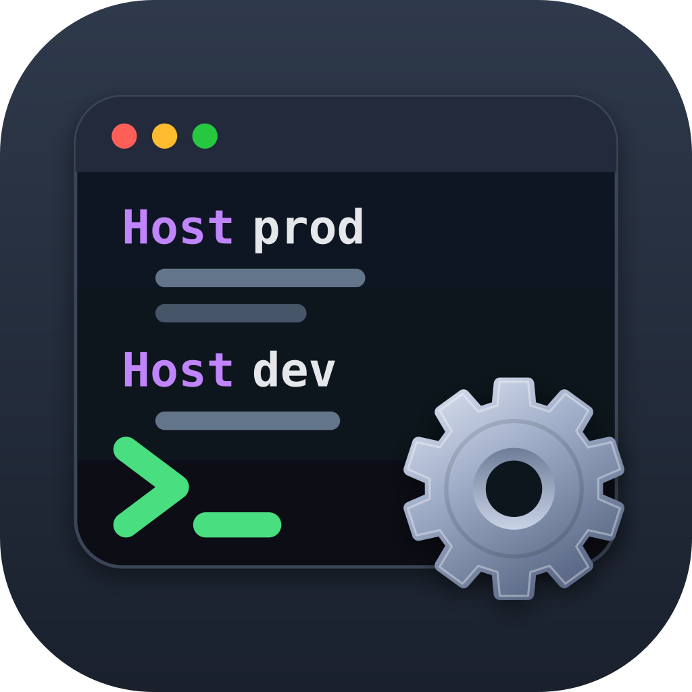

<p align="center">
  
</p>

<h1 align="center">SSH Config Manager</h1>

<p align="center">
  <code>~/.ssh/config</code> dosyanızı yöneten, sunuculara iki tuşla bağlanmanızı sağlayan native bir macOS uygulaması.
</p>

<p align="center">
  
  
  
  
</p>

---

Config dosyası, uygulamanın tek doğruluk kaynağıdır. Uygulama host bilgilerini başka bir yerde saklamaz. Dosyayı açıp hiçbir şeyi değiştirmeden kaydettiğinizde dosya bayt bayt aynı kalır. Bir host'u düzenlediğinizde ise yalnızca o satırlar değişir; yorumlar, girintiler, `Include` ve `Match` blokları olduğu gibi korunur.

## Özellikler

### Hızlı bağlanma

- **Global kısayol ⌥⌘S:** Her yerden bir arama paneli açar. Arama yazmadan ↩ ile en son bağlandığınız host'a bağlanırsınız.
- **Menü çubuğu:** Aynı arama ve bağlanma ekranı menü çubuğunda da var. İsterseniz uygulama girişte yalnızca menü çubuğunda açılır.
- **Akıllı arama:** `prd web` yazdığınızda `prod-web-01` ilk sırada çıkar. Arama alias'ta bulanık, HostName, User ve grup adında ise düz metin olarak eşleşir.
- **Favoriler ve son bağlanılanlar:** Arama boşken listenin başında görünürler.
- **Bağlanma önizlemesi:** Seçili host için `user@hostname:port · bastion üzerinden` satırı gösterilir.
- **Terminal seçimi:** Terminal, iTerm2 ya da Ghostty. Bağlantı seçtiğiniz terminalde açılır.

| Kısayol | Panel / menü çubuğu |
|---|---|
| ↩ | Bağlan |
| ⌘↩ | Bağlantıyı test et |
| ⌥↩ | `ssh` komutunu kopyala |
| ⌘S | Favorilere ekle / çıkar |

### Güvenli düzenleme

- **Kayıpsız düzenleme:** Dosyada yalnızca değiştirdiğiniz satırlar değişir. Aynı ayar birden fazla kez yazılmışsa hiçbiri kaybolmaz.
- **Diff önizlemesi:** Kaydetmeden önce dosyada tam olarak neyin değişeceğini görürsünüz.
- **Doğrulama:** Her kayıt `ssh -G` ile denetlenir. Uygulama ssh'in okuyamayacağı bir dosya yazmaz.
- **Yedekleme ve atomik yazma:** Her kayıttan önce zaman damgalı bir yedek alınır. Yedekler Ayarlar'dan karşılaştırılıp geri yüklenebilir.
- **Dış değişiklik takibi:** Dosya başka bir editörde değişirse uygulama bunu fark eder ve düzenlemelerinizi ezmez.
- **Gruplar:** Host'ları `# group:` yorumlarıyla gruplayabilirsiniz. ssh bu satırları yorum olarak okur ve yok sayar.

### Config'i anlama

- **Etkin ayarlar:** Bir host'un `ssh -G` ile çözülmüş ayarlarını ve her ayarın nereden geldiğini gösterir: bu blok, `Host *`, başka bir desen, bir Include dosyası ya da ssh varsayılanı.
- **ProxyJump zinciri:** `Bu Mac → bastion → prod-db` şeklinde gösterilir ve zincir baştan sona test edilebilir.
- **Uyarı rozetleri:** Bulunamayan `IdentityFile`, iki kez tanımlanmış alias ve yalnızca büyük/küçük harfle ayrılan alias'lar işaretlenir.
- **Bağlantı testi:** Sonuçlar anlaşılır şekilde sınıflandırılır: bağlantı reddedildi, zaman aşımı, kimlik doğrulama hatası, host anahtarı değişti.

### Known Hosts

- `known_hosts` kayıtlarını listeler. Hash'lenmiş kayıtlarda da arama yapabilirsiniz.
- Silme işlemi `ssh-keygen -R`'nin sileceği satırların tam olarak aynısını siler, fazlasını silmez.
- Host anahtarı değiştiğinde eski kaydı tek adımda kaldırabilirsiniz.

### Anahtarlar

- `~/.ssh` içindeki anahtarları türü, parmak izi, parola durumu ve hangi host'larda kullanıldığıyla birlikte listeler.
- **Oluşturma:** Yeni anahtar oluşturur ve isterseniz bir host'a atar. Mevcut bir anahtarın üzerine asla yazmaz.
- **Diğer işlemler:** Anahtarı agent'a ekleme, sunucuya yükleme (`ssh-copy-id`), parola değiştirme ve çöp kutusuna taşıma.

## Kurulum

[Releases](https://github.com/messcenter/SSHConfigManager/releases/latest) sayfasından en son `SSH-Config-Manager-<sürüm>.dmg` dosyasını indirin, açın ve **SSH Config Manager**'ı Uygulamalar klasörüne sürükleyin. Uygulama Developer ID ile imzalı ve Apple tarafından notarize edilmiştir; Gatekeeper uyarısı vermeden açılır.

İlk bağlantıda macOS, uygulamanın terminalinizi kontrol etmesi için izin ister. Bağlanmak için bu izin gerekir. İzni daha sonra **Sistem Ayarları → Gizlilik ve Güvenlik → Otomasyon** bölümünden değiştirebilirsiniz.

## Kaynaktan derleme

**Gereksinimler:** macOS 26, Xcode 27, [XcodeGen](https://github.com/yonaskolb/XcodeGen) ve `python3`.

```bash
git clone https://github.com/messcenter/SSHConfigManager.git
cd SSHConfigManager
xcodegen generate
open SSHConfigManager.xcodeproj
```

Xcode projesi `project.yml` dosyasından üretilir ve depoya dahil değildir. Proje ayarlarını değiştirmek için `project.yml`'i düzenleyip `xcodegen generate` komutunu yeniden çalıştırın.

### Testler

```bash
# SSHConfigKit paketi: parser, known_hosts, anahtarlar, süreç yönetimi
xcrun swift test --package-path Packages/SSHConfigKit

# Uygulama: yerelleştirme denetimi ve uygulama testleri
bash scripts/test-app.sh
```

Testler gerçek `~/.ssh` dizininize, ssh-agent'ınıza, keychain'inize ya da `UserDefaults`'a dokunmaz ve hiçbir sunucuya bağlanmaz. Gereken her şey geçici dizinlerde ve sahte süreçlerle hazırlanır.

### Sürüm alma

```bash
SIGN_IDENTITY="Developer ID Application: <Ad> (<TEAMID>)" \
TEAM_ID=<TEAMID> NOTARY_PROFILE=sshcm-notary \
scripts/build-release.sh
```

Bu komut imzalı ve notarize edilmiş `build/SSH-Config-Manager-<sürüm>.dmg` dosyasını üretir. `SIGN_IDENTITY` verilmezse yalnızca bu Mac'te denemek için ad-hoc imzalı bir kopya üretilir. Ayrıntılar ve sürüm öncesi kontrol listesi için [docs/design/release.md](docs/design/release.md) dosyasına bakın.

## Proje yapısı

```
SSHConfigManager/
├── project.yml                 XcodeGen tanımı (sürüm, imza, Info.plist)
├── SSHConfigManager/           SwiftUI uygulaması
│   ├── App/                    Uygulama, menüler, menü çubuğu
│   ├── Features/               HostList, HostDetail, QuickConnect, Connect,
│   │                           KnownHosts, Keys, Settings
│   └── Shared/                 AppModel, ayarlar, yerelleştirme (String Catalog)
├── Packages/SSHConfigKit/      UI'dan bağımsız, bağımlılıksız Swift paketi
│   └── Sources/SSHConfigKit/
│       ├── Config/             Kayıpsız parser, düzenleme, doğrulama, diff
│       ├── Resolve/            Etkin ayarlar ve kaynakları, uyarılar
│       ├── KnownHosts/         known_hosts modeli, ssh-keygen ile uyumlu eşleşme
│       ├── Keys/               Anahtar tarama ve yönetimi
│       ├── IO/                 Atomik yazma, yedekler, dosya izleme
│       ├── Process/            Süreç grubu yönetimli ProcessRunner
│       ├── SSH/                ssh -G, bağlantı testi, komut üretimi
│       └── Stores/             @Observable durum
├── SSHConfigManagerTests/      Uygulama testleri
├── scripts/                    Test, yerelleştirme denetimi, sürüm
└── docs/design/                Tasarım dokümanları, planlar, el ile test listesi
```

Uygulamanın tek dış bağımlılığı [KeyboardShortcuts](https://github.com/sindresorhus/KeyboardShortcuts) paketidir (MIT). `SSHConfigKit` paketinin hiç dış bağımlılığı yoktur.

## Gizlilik ve izinler

- Uygulama sandbox dışında çalışır, çünkü `~/.ssh` dizinine erişmesi, `ssh`/`ssh-keygen` çalıştırması ve terminalleri Apple Events ile kontrol etmesi gerekir.
- Hiçbir veriyi dışarı göndermez. Ayarlar, favoriler ve son bağlanılanlar yalnızca bu Mac'teki `UserDefaults` içinde tutulur.
- Config dosyasına uygulamaya özgü tek ekleme, isteğe bağlı `# group:` yorum satırlarıdır.

## Yerelleştirme

Arayüz İngilizce (kaynak dil) ve Türkçe olarak hazırlanmıştır. Uygulama macOS'in dil ayarını izler. Bütün metinler `Localizable.xcstrings` dosyasındadır. `scripts/check-localization.py`, eksik çevirileri ve yerelleştirilmemiş metinleri derlemeden önce yakalar.

## Belgeler

| Belge | İçerik |
|---|---|
| [Tasarım dokümanı](docs/design/2026-10-07-ssh-config-manager-design.md) | Amaç, mimari, güvenli düzenleme kuralları |
| [Arayüz geliştirmeleri v1.1](docs/design/2026-10-09-ui-improvements-design.md) | Hızlı bağlanma, etkin ayarlar, gruplar |
| [El ile test listesi](docs/design/manual-test-checklist.md) | Sürüm öncesi elle yapılacak kontroller |
| [Sürüm alma](docs/design/release.md) | İmzalama, notarize, `.dmg` |
